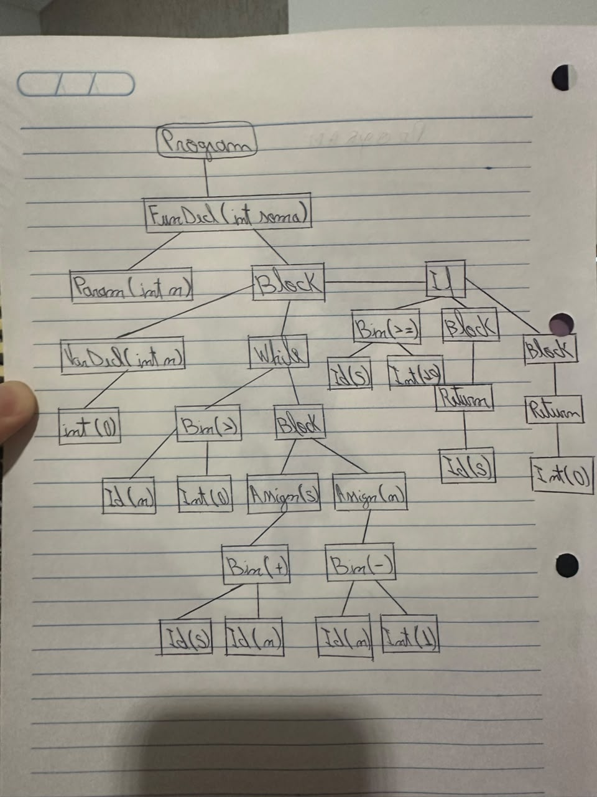

# Checkpoint 3 — Projeto da AST e do Visitor


A gramática é a do CP2 (`cp2/gramatica-first-follow.md`), **sem nenhuma mudança**. Por isso não há `gramatica-first-follow.md`. O scanner (`Scanner`, `Token`, `TokenType`, `LexicalError`, `Estado`) é o arquivo do CP1, sem modificação.

## 1. Critério

A AST tem **um tipo de nó por categoria sintática que importa para as fases seguintes**, e não um por não-terminal. A árvore guarda o que a tabela de símbolos e a análise semântica vão precisar:

- o que foi declarado (nome, tipo, parâmetros);
- o que cada comando faz;
- a estrutura de cada expressão (operador e operandos já agrupados pela precedência).

Ela não guarda como o parser chegou lá: níveis de precedência, caudas `XxxRest`, fatorações e pontuação ficam de fora.

## 2. Hierarquia de nós

```
Node (abstrata: line, col, accept)
├── Program
├── FuncDecl            implements TopDecl
├── ProcDecl            implements TopDecl
├── Param
├── TypeNode
├── Stmt (abstrata)
│   ├── VarDecl         implements TopDecl   (global ou local)
│   ├── Block
│   ├── Assign
│   ├── CallStmt
│   ├── If
│   ├── While
│   └── Return
└── Expr (abstrata)
    ├── IntLit, DoubleLit, BoolLit, CharLit, StringLit
    ├── Id
    ├── Bin
    ├── Unary
    └── Call
```

`TopDecl` é uma interface que marca o que pode aparecer no nível superior. `VarDecl` é ao mesmo tempo `Stmt` (declaração local) e `TopDecl` (global). Assim `Program` tem uma lista de `TopDecl` e `Block` tem uma lista de `Stmt`, e o próprio sistema de tipos do Java impede uma função dentro de um bloco.

Enums auxiliares (não são nós, são valores de atributo): `Tipo` {`INT`, `DOUBLE`, `BOOL`, `CHAR`, `STRING`}, `BinOp` {`OR`, `AND`, `EQ`, `NE`, `LT`, `LE`, `GT`, `GE`, `ADD`, `SUB`, `MUL`, `DIV`, `MOD`} e `UnOp` {`NOT`, `NEG`}.

Todos os nós têm `int line, int col`, herdados de `Node` (seção 4).

| Nó | Atributos (tipo) | Produção(ões) do CP2 que o geram |
| --- | --- | --- |
| `Program` | `decls: List<TopDecl>` | `Programa → DeclsTop EOF` (+ `DeclsTop → DeclTop DeclsTop \| ε`) |
| `VarDecl` | `type: TypeNode`, `name: String`, `init: Expr` (null sem `=`) | global: `DeclTop → Tipo ID DeclTopResto`, `DeclTopResto → VarResto`, `VarResto → InitOpt ';'`; local: `Stmt → Tipo ID InitOpt ';'` |
| `FuncDecl` | `returnType: TypeNode`, `name: String`, `params: List<Param>`, `body: Block` | `DeclTop → Tipo ID DeclTopResto`, `DeclTopResto → FuncResto`, `FuncResto → '(' Params ')' Bloco` |
| `ProcDecl` | `name: String`, `params: List<Param>`, `body: Block` | `DeclTop → 'void' ID FuncResto` |
| `Param` | `type: TypeNode`, `name: String` | `Param → Tipo ID` |
| `TypeNode` | `tipo: Tipo` | `Tipo → 'int' \| 'double' \| 'bool' \| 'char' \| 'string'` |
| `Block` | `stmts: List<Stmt>` | `Bloco → '{' ListaStmt '}'` (+ `ListaStmt`) |
| `Assign` | `name: String`, `value: Expr` | `Stmt → ID StmtId`, `StmtId → '=' Expr ';'` |
| `CallStmt` | `call: Call` | `Stmt → ID StmtId`, `StmtId → '(' Args ')' ';'` |
| `If` | `cond: Expr`, `thenBlock: Block`, `elseBranch: Stmt` (null, `Block` ou `If`) | `Stmt → 'if' '(' Expr ')' Bloco ElseOpt`; `ElseTail → 'if' '(' Expr ')' Bloco ElseOpt` |
| `While` | `cond: Expr`, `body: Block` | `Stmt → 'while' '(' Expr ')' Bloco` |
| `Return` | `value: Expr` (null em `return;`) | `Stmt → 'return' ReturnOpt ';'` |
| `IntLit` | `lexeme: String` | `Primary → INT_LIT` |
| `DoubleLit` | `lexeme: String` | `Primary → DOUBLE_LIT` |
| `BoolLit` | `value: boolean` | `Primary → 'true' \| 'false'` |
| `CharLit` | `valor: String` (entre as aspas, escape como no fonte) | `Primary → CHAR_LIT` |
| `StringLit` | `valor: String` (entre as aspas, escapes como no fonte) | `Primary → STRING_LIT` |
| `Id` | `name: String` | `Primary → ID PrimaryIdRest`, `PrimaryIdRest → ε` |
| `Bin` | `op: BinOp`, `left: Expr`, `right: Expr` | `OrRest → '\|\|' …`, `AndRest → '&&' …`, `EqRest → '==' \| '!=' …`, `RelRest → '<' \| '<=' \| '>' \| '>=' …`, `AddRest → '+' \| '-' …`, `MulRest → '*' \| '/' \| '%' …` |
| `Unary` | `op: UnOp`, `operand: Expr` | `Unary → '!' Unary \| '-' Unary` |
| `Call` | `name: String`, `args: List<Expr>` | `Primary → ID PrimaryIdRest`, `PrimaryIdRest → '(' Args ')'`; e dentro de `CallStmt` |

Isso cobre o escopo fixo: programa; declarações de variável, procedimento e função com parâmetros; tipos; os comandos bloco, atribuição, seleção, repetição, chamada e retorno; e as expressões (literais dos cinco tipos, identificador, binária, unária e chamada de função).

### 2.1 Decisões de representação

1. **Procedimento e função são nós diferentes** (`ProcDecl` × `FuncDecl`), como na gramática (`'void' ID FuncResto` × `Tipo ID DeclTopResto`). Assim `FuncDecl.returnType` nunca é nulo e a semântica sabe, sem consultar nada, se `return expr;` é permitido.
2. **Chamada como comando × chamada como expressão.** Existe um só nó `Call` (nome + argumentos). Quando a chamada é um comando, ela fica embrulhada em `CallStmt`. A semântica vai usar isso: num `CallStmt` um procedimento é aceito; num `Call` dentro de expressão a função precisa devolver valor.
3. **`else if` não tem nó próprio.** `If.elseBranch` é `null` (sem else), um `Block` (`else { }`) ou outro `If` (`else if`). Isso espelha `ElseTail`.
4. **Os nomes declarados ficam como `String`** em `VarDecl`, `Param`, `FuncDecl`, `ProcDecl`, `Assign` e `Call`, e o uso de variável é um `Id`. Um identificador é uma folha com informação, não um nó com filhos.
5. **Literais numéricos guardam o lexema** (`"10"`, `"3.14"`), e não o valor convertido. O léxico não limita o tamanho (`99999999999` é um `INT_LIT` válido); converter aqui poderia lançar exceção no parser. Converter e checar a faixa é tarefa da semântica. Strings e chars guardam o conteúdo entre as aspas com os escapes como no fonte (`diz \"oi\"`), para que a reimpressão seja exata.
6. **`TypeNode` é um nó, não só um enum.** Ele guarda a posição do tipo escrito, útil para mensagens como "tipo incompatível na declaração em 3:5".
7. **Listas são `java.util.List`.** Uma lista vazia (`f()`, `void p() {}`, bloco vazio) é uma lista vazia, nunca `null`.

### 2.2 Campos que virão depois (sem mudar a forma da árvore)

- **Tabela de símbolos:** um campo `public Symbol simbolo;` em `Id`, `Call`, `Assign`, `VarDecl`, `Param`, `FuncDecl` e `ProcDecl` (os nós que usam ou declaram um nome). Esses nós estão marcados com "(Futuro: campo para o símbolo.)" no Javadoc.
- **Semântica:** um campo `public Tipo tipo;` na classe abstrata `Expr`, herdado por todas as expressões (o comentário está em `Expr.java`). O enum `Tipo` vai precisar de um valor de erro e talvez de `VOID` nesse momento.

Os dois casos são campos novos, sem filhos novos: a forma da árvore e os visitors existentes continuam iguais.

## 3. Mapeamento da gramática para a árvore

Cada não-terminal do CP2 vira **um nó**, vira **um atributo** de outro nó, ou **não vira nada**.

| Não-terminal | Vira | Justificativa (para os que não viram nó) |
| --- | --- | --- |
| `Programa` | nó `Program` | |
| `DeclsTop` | atributo `Program.decls` (lista) | recursão à direita que só existe para repetir `DeclTop` |
| `DeclTop` | nó `VarDecl`, `FuncDecl` ou `ProcDecl` | |
| `DeclTopResto` | nada — **(c) fatoração** | só adia a escolha entre função e variável; o parser escolhe o nó e passa tipo e nome adiante |
| `FuncResto` | nada — **(c) fatoração**; vira os atributos `params` e `body` | é a parte comum de função e procedimento, separada pela fatoração |
| `VarResto` | nada — **(c) fatoração**; vira o atributo `init` | é a parte que sobrou de `Tipo ID InitOpt ';'` depois de fatorar |
| `InitOpt` | atributo `VarDecl.init` (`null` no ε) | uma parte opcional é um atributo que pode faltar, não um nó |
| `Tipo` | nó `TypeNode` | |
| `Params` | atributo `params` (lista, vazia no ε) | |
| `ListaParams` | nada (preenche a lista) | só existe para repetir `Param` |
| `ListaParamsRest` | nada — **(b) eliminação da recursão à esquerda** | criado ao reescrever `ListaParams → ListaParams ',' Param`; a vírgula é só separador |
| `Param` | nó `Param` | |
| `Bloco` | nó `Block` | |
| `ListaStmt` | atributo `Block.stmts` (lista) | recursão à direita que só repete `Stmt` |
| `Stmt` | nó concreto conforme a alternativa: `VarDecl`, `Assign`/`CallStmt`, `If`, `While`, `Return` ou `Block` | não há nó "Stmt" genérico; `Stmt` é só a classe abstrata |
| `StmtId` | nada — **(c) fatoração** | decide entre `Assign` e `CallStmt` depois do `ID` comum |
| `ElseOpt` | atributo `If.elseBranch` (`null` no ε) | parte opcional do `if` |
| `ElseTail` | o `Block` ou o `If` aninhado que vai em `elseBranch` | só escolhe entre `else {}` e `else if` |
| `ReturnOpt` | atributo `Return.value` (`null` no ε) | parte opcional |
| `Args` | atributo `args` (lista, vazia no ε) | |
| `ListaArgs` | nada (preenche a lista) | só repete `Expr` |
| `ListaArgsRest` | nada — **(b) eliminação da recursão à esquerda** | criado ao reescrever `ListaArgs → ListaArgs ',' Expr` |
| `Expr` | nada (devolve o nó do `OrExpr`) | só dá nome ao topo da hierarquia de precedência |
| `OrExpr`, `AndExpr`, `EqExpr`, `RelExpr`, `AddExpr`, `MulExpr` | nada — **(a) precedência** (os "T" e "F" da aula) | cada nível existe para fixar a precedência na gramática; na AST a precedência já está na **forma** da árvore (quem é filho de quem) |
| `OrRest`, `AndRest`, `EqRest`, `RelRest`, `AddRest`, `MulRest` | nada — **(b) eliminação da recursão à esquerda** (os "E'" e "T'" da aula) | recebem o operando esquerdo já construído e devolvem o `Bin` maior; na alternativa ε devolvem o próprio operando |
| `Unary` | nó `Unary` (alternativas `!` e `-`); na alternativa `Primary`, nada (devolve o nó do `Primary`) | |
| `Primary` | o nó do literal, `Id`, `Call`, ou o nó da expressão entre parênteses | `'(' Expr ')'` não vira nó: o agrupamento já está na árvore |
| `PrimaryIdRest` | nada — **(c) fatoração** | decide entre `Id` e `Call` depois do `ID` comum |


- **(a) Precedência:** `OrExpr`, `AndExpr`, `EqExpr`, `RelExpr`, `AddExpr`, `MulExpr` (e `Expr`, `Unary → Primary`).
- **(b) Eliminação da recursão à esquerda:** `OrRest`, `AndRest`, `EqRest`, `RelRest`, `AddRest`, `MulRest`, `ListaParamsRest`, `ListaArgsRest`.
- **(c) Fatoração à esquerda:** `DeclTopResto`, `FuncResto`, `VarResto`, `StmtId`, `PrimaryIdRest`.

**Pontuação e palavras-chave não viram nó:** `(`, `)`, `{`, `}`, `,`, `;`, `=` (da atribuição e da inicialização), `if`, `else`, `while`, `return`, `void` e `EOF`. Elas só servem para o parser decidir e delimitar. Na árvore, a informação delas já está no tipo do nó (um `If` já diz que houve `if`) ou na forma (o que estava entre `{}` é a lista do `Block`).

### 3.1 Como os `XxxRest` montam a árvore

Cada `parseXxxExpr()` guarda o primeiro token, constrói o operando esquerdo e chama `parseXxxRest(esq, inicio)`:

```java
// AddRest -> ('+' | '-') MulExpr AddRest | ε
private Expr parseAddRest(Expr esq, Token inicio) {
    if (in(OP_ADD)) {
        BinOp op = BinOp.deSimbolo(lookahead.lexeme);
        advance();
        Expr dir = parseMulExpr();
        return parseAddRest(new Bin(op, esq, dir, inicio.line, inicio.col), inicio);
    } else if (in(FOLLOW_ADDREST)) {
        return esq;                         // ε
    } ...
}
```

Para `a - b - c`: `esq = a`; lê `- b` e chama `AddRest` com `Bin(-, a, b)`; lê `- c` e chama com `Bin(-, Bin(-, a, b), c)`; no ε devolve esse nó. O resultado é `(a - b) - c`, associativo à esquerda, mesmo com a gramática recursiva à direita. A precedência sai da ordem das chamadas: `a + b * c` monta `b * c` inteiro dentro de `parseMulExpr()` antes de o `AddRest` criar o `Bin(+)`.

## 4. Posição

Todo nó guarda `line` e `col` do **primeiro token que o originou**. O `Token` do CP1 já guarda os dois.

| Nó | Primeiro token |
| --- | --- |
| `VarDecl`, `FuncDecl`, `Param` | o tipo (`int` de `int x = 1;`) |
| `ProcDecl` | o `void` |
| `Assign`, `CallStmt`, `Call`, `Id` | o identificador |
| `If`, `While`, `Return` | a palavra-chave |
| `Block` | o `{` |
| `Bin` | o primeiro token do operando **esquerdo** (`a` em `a - b`; o primeiro `a` em `a - b - c`, para os dois `Bin`) |
| `Unary` | o operador (`!` ou `-`) |
| literais | o próprio literal |
| `Program` | o primeiro token do arquivo (ou o `EOF`, se vazio) |

Expressão entre parênteses: como o parêntese não vira nó, o nó interno fica com a posição do seu próprio primeiro token, e não a do `(`. Para `(a + b) * c`, o `Bin(*)` começa em `(`, que é o primeiro token do `MulExpr`; o `Bin(+)` começa em `a`.

O teste `posição` em `AstTest` confere alguns desses casos.

## 5. Formato do impressor de árvore (`visitor/TreePrinter`)

- Um nó por linha, terminada em `\n` (sem `\r`).
- Indentação de **2 espaços por nível** de profundidade; a raiz não tem indentação.
- Os filhos aparecem logo abaixo do pai, um nível mais fundo, **na ordem dos atributos** da tabela da seção 2.
- Atributos que não são nós aparecem **entre parênteses ao lado do nome**:

| Nó | Linha | Filhos, em ordem |
| --- | --- | --- |
| `Program` | `Program` | as declarações |
| `VarDecl` | `VarDecl(<tipo> <nome>)` | a inicialização, se houver |
| `FuncDecl` | `FuncDecl(<tipo> <nome>)` | os `Param`, depois o `Block` |
| `ProcDecl` | `ProcDecl(<nome>)` | os `Param`, depois o `Block` |
| `Param` | `Param(<tipo> <nome>)` | — |
| `Block` | `Block` | os comandos |
| `Assign` | `Assign(<nome>)` | a expressão |
| `CallStmt` | `CallStmt` | o `Call` |
| `If` | `If` | condição, bloco do então, e o ramo else (`Block` ou `If`), se houver |
| `While` | `While` | condição, corpo |
| `Return` | `Return` | a expressão, se houver |
| `IntLit` / `DoubleLit` | `Int(10)` / `Double(3.14)` | — |
| `BoolLit` | `Bool(true)` | — |
| `CharLit` | `Char('a')` (com as aspas) | — |
| `StringLit` | `Str("texto")` (com as aspas) | — |
| `Id` | `Id(<nome>)` | — |
| `Bin` | `Bin(<op>)` | esquerdo, direito |
| `Unary` | `Un(<op>)` | operando |
| `Call` | `Call(<nome>)` | os argumentos |

O `TypeNode` sai **na linha da declaração** (`VarDecl(int x)`), e não como filho; se alguém imprimir um `TypeNode` sozinho, sai `Type(int)`. As posições **não** são impressas, para que as árvores esperadas possam ser escritas à mão sem contar colunas.

O formato é determinístico e distingue duas árvores diferentes. Os filhos opcionais (inicialização, else, valor do return) não criam ambiguidade, porque a indentação diz de quem cada linha é filha, e o ramo else é sempre o terceiro filho do `If`, depois de um `Block`.

Exemplo do enunciado, `a - b - c * d`:

```
Bin(-)
  Bin(-)
    Id(a)
    Id(b)
  Bin(*)
    Id(c)
    Id(d)
```

## 6. Reimpressor de código-fonte (`visitor/SourcePrinter`)

Gera o programa na sintaxe concreta, em forma canônica:

- uma declaração de nível superior por linha (funções ocupam várias linhas);
- um comando por linha, com indentação de 4 espaços por bloco;
- `{` na mesma linha do cabeçalho e `}` sozinho; `} else {` e `} else if (...) {` na mesma linha;
- **toda expressão binária e unária entre parênteses:** `(a + (b * c))`, `(-x)`, `(!(a < b))`. Por isso aparecem parênteses duplos em `if ((a > b))`: os do `if` e os da expressão;
- comentários não existem na AST e não são reimpressos.

A prova de que a árvore não perdeu nada que importe é o teste de ida e volta: o texto gerado é lido de novo pelo parser, e a segunda reimpressão e a segunda árvore são iguais às primeiras.

O `If` com `else if` não precisa de `instanceof`: `visitIf` escreve `" else "` e pede ao próprio ramo que se imprima; um `Block` imprime `{ ... }` e um `If` imprime `if (...) { ... }`. A escolha é feita pelo double dispatch.

### 6.1 O segundo visitor exigiu mudar algum nó?

Não. O `SourcePrinter` foi escrito depois do `TreePrinter` e não tocou em nenhuma classe de `ast/`. Ele só usa os atributos públicos e o `accept` que já existiam. Os únicos pontos que tiveram de ser decididos já no desenho original, pensando na reimpressão, foram:

- guardar o **lexema** dos literais numéricos e o conteúdo **com os escapes** de strings e chars (decisão 5 da seção 2.1), para reimprimir exatamente o que foi lido;
- separar `CallStmt` de `Call`, para saber quando escrever o `;` depois da chamada.

## 7. Árvore desenhada à mão

Programa (também em `exemplos/arvore-desenhada`):

```
int soma(int n) {
    int s = 0;
    while (n > 0) {
        s = s + n;
        n = n - 1;
    }
    if (s >= 10) { return s; } else { return 0; }
}
```

Árvore desenhada à mão pelo grupo (29 nós; arquivo `exemplos/arvore-desenhada.jpeg`):



A mesma AST em texto, com a posição (linha:coluna) do primeiro token de cada nó. São **29 nós**: uma função, uma repetição e uma seleção.

```
Program                                   1:1
└── FuncDecl(int soma)                    1:1
    ├── Param(int n)                      1:10
    └── Block                             1:17
        ├── VarDecl(int s)                2:5
        │   └── Int(0)                    2:13
        ├── While                         3:5
        │   ├── Bin(>)                    3:12
        │   │   ├── Id(n)                 3:12
        │   │   └── Int(0)                3:16
        │   └── Block                     3:19
        │       ├── Assign(s)             4:9
        │       │   └── Bin(+)            4:13
        │       │       ├── Id(s)         4:13
        │       │       └── Id(n)         4:17
        │       └── Assign(n)             5:9
        │           └── Bin(-)            5:13
        │               ├── Id(n)         5:13
        │               └── Int(1)        5:17
        └── If                            7:5
            ├── Bin(>=)                   7:9
            │   ├── Id(s)                 7:9
            │   └── Int(10)               7:14
            ├── Block                     7:18
            │   └── Return                7:20
            │       └── Id(s)             7:27
            └── Block                     7:37
                └── Return                7:39
                    └── Int(0)            7:46
```

**Pedaços da árvore de derivação que a AST descartou:**

1. **A cadeia de precedência até uma folha.** Na derivação, o `n` de `n > 0` sai por `Expr → OrExpr → AndExpr → EqExpr → RelExpr → AddExpr → MulExpr → Unary → Primary → ID PrimaryIdRest`, com `PrimaryIdRest → ε`. Além disso, cada nível deixa um `XxxRest → ε` pendurado (`MulRest`, `AddRest`, e depois `EqRest`, `AndRest`, `OrRest` em volta do `>`). Na AST, tudo isso virou **um único `Id(n)`**, filho do `Bin(>)`.
2. **A cauda `AddRest` de `s + n`.** A derivação tem `AddExpr → MulExpr AddRest` e `AddRest → '+' MulExpr AddRest`, com o `AddRest` final em ε. Na AST, isso virou **um `Bin(+)` com dois filhos**; o `AddRest` e o seu ε sumiram, e o `+` virou atributo do `Bin`.
3. **A fatoração da declaração da função.** A derivação passa por `DeclTop → Tipo ID DeclTopResto`, `DeclTopResto → FuncResto`, `FuncResto → '(' Params ')' Bloco`, `Params → ListaParams`, `ListaParams → Param ListaParamsRest` e `ListaParamsRest → ε`. Na AST, sobrou **um `FuncDecl` com uma lista de um `Param` e um `Block`**; `DeclTopResto`, `FuncResto`, `ListaParams`, `ListaParamsRest` e os parênteses sumiram.
4. **A lista de comandos.** `ListaStmt → Stmt ListaStmt` aninhado três vezes, terminando em `ListaStmt → ε`, virou a **lista plana** de três filhos do `Block` da função.
5. **O `else`.** `ElseOpt → 'else' ElseTail` e `ElseTail → Bloco` viraram só o **terceiro filho do `If`**.
6. **O `int s = 0`.** `InitOpt → '=' Expr` e toda a cadeia de precedência até `INT_LIT` viraram o filho `Int(0)` do `VarDecl`; o `=` e o `;` sumiram.

## 8. Parser e erros

- Cada `parseX()` que corresponde a um nó devolve esse nó; `parse()` devolve um `ParseResult` com `program`, `syntaxErrors`, `lexicalErrors` e `aceito`.
- **Com qualquer erro (léxico ou sintático), `ParseResult.program` é `null`.** A árvore parcial é descartada e não pode seguir para a semântica.
- Durante a recuperação, um `parseX()` que encontrou erro devolve `null` no lugar do nó que faltou. Nenhum construtor de nó desreferencia os filhos, e a posição de cada nó vem de um `Token` guardado **antes** de chamar os filhos (nunca de `filho.line`). Então a árvore parcial não causa `NullPointerException`. O `TreePrinter` também aceita filhos nulos (imprime `?`), útil para depurar.
- O reconhecimento (decisões por FIRST, ε por FOLLOW, `recupera`/`sincroniza`, âncoras, mensagens de erro) é o do CP2. A única reorganização é `parseIf()`: o `if` de `Stmt` e o de `ElseTail` têm exatamente a mesma sequência de símbolos e agora usam o mesmo método. A suíte do CP2 (`test/ParserTest.java`) roda contra o parser novo com os **mesmos veredictos**.

## 9. Como compilar e rodar

A partir da pasta `cp3` (Java 11 ou mais novo):

```
javac -encoding UTF-8 -d out src/*.java src/ast/*.java src/visitor/*.java test/*.java
java -cp out AstTest                                  # testes do CP3
java -cp out ParserTest                               # regressão do CP2
java -cp out ParserMain exemplos/valido.txt           # imprime a AST
java -cp out ParserMain exemplos/valido.txt --fonte   # reimprime o fonte
```

